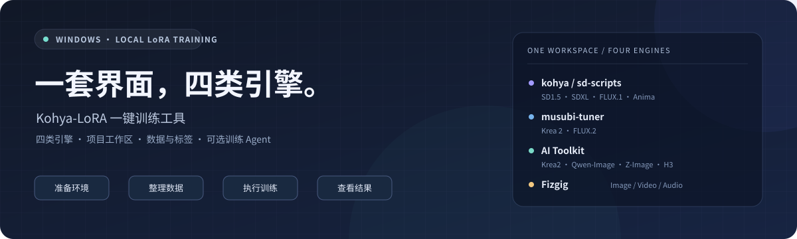

<p align="center">
  
</p>

<h1 align="center">Kohya-LoRA Tool</h1>

<p align="center">
  <a href="https://github.com/l1934332574-maker/Kohya-LoRA-Tool/releases/latest"></a>
  
  <a href="LICENSE"></a>
</p>

<p align="center">
  <a href="README.zh-CN.md">简体中文</a> ·
  <a href="https://github.com/l1934332574-maker/Kohya-LoRA-Tool/releases/latest">Download</a> ·
  <a href="https://modelscope.cn/models/FGtiancai/Kohya-LoRA-Tool">China mirror</a> ·
  <a href="CHANGELOG.md">Changelog</a> ·
  <a href="https://github.com/l1934332574-maker/Kohya-LoRA-Tool/issues">Issues</a>
</p>

Train character, style and concept LoRAs on Windows with **four engines in one workspace**.

Chinese UI · NVIDIA GPUs · Selected AMD ROCm configurations

## Features

- **Unified training** — kohya, musubi-tuner, AI Toolkit and Fizgig.
- **Guided setup** — engine installation, model downloads and local model selection.
- **Dataset tools** — WD14 / PixAI tagging, caption editing and image-to-prompt tools.
- **Training and review** — presets, project management, fixed-seed samples and A/B comparisons.
- **AI assistance** — optional in-app assistant and local MCP access for external agents.
- **Concept sliders** — text-guided and image-pair LoRA training for SDXL and standard Anima; experimental.

## Supported models

| Engine | Models |
| --- | --- |
| **kohya / sd-scripts** | SD 1.5, SDXL, FLUX.1, Anima |
| **musubi-tuner** | Krea 2, FLUX.2 |
| **AI Toolkit** | Krea 2, Qwen-Image, Z-Image Base, MiniMax H3 |
| **Fizgig** | Krea 2, FLUX.2 Klein 9B, Qwen-Image-2.1, Z-Image Turbo, MiniMax H3, MOSS-Image Base; experimental SDXL / standard Anima |

MiniMax H3 also supports video through AI Toolkit and image / video / audio through Fizgig. Model versions, GPU requirements and available features vary by engine; see the [user guide](README_使用说明.md).

MOSS-Image uses Fizgig v8.5.0 with separate Base training and SFT preview models. [Setup and 8GB validation](docs/MOSS_Image_Fizgig_v850_验证与接入_20261018.md).

## Quick start

1. Download `Setup.exe` from [Releases](https://github.com/l1934332574-maker/Kohya-LoRA-Tool/releases/latest) or [ModelScope](https://modelscope.cn/models/FGtiancai/Kohya-LoRA-Tool). For the portable edition, extract the ZIP and run `Kohya一键工具.exe`.
2. Create a project, select a model and follow the setup guide.
3. Import images, review captions and parameters, then train.

## Resources

[User guide](README_使用说明.md) · [MCP](docs/MCP.md) · [Development](modern_ui/README.md) · [Changelog](CHANGELOG.md)

**QQ group: 602396066** · [Report an issue](https://github.com/l1934332574-maker/Kohya-LoRA-Tool/issues)

<details>
<summary>Run from source</summary>

Python 3.12 · Node.js 20.19+ or 22.12+ · WebView2

```powershell
python -m pip install customtkinter pillow -r requirements-ui.txt
npm --prefix modern_ui ci
npm --prefix modern_ui run build
python kohya_gui.py
```

</details>

## Code signing policy

Signing preparation is in progress; current releases are unsigned. [Policy](docs/CODE_SIGNING.md) · [Privacy](docs/PRIVACY.md).

## License

[MIT](LICENSE) · [Third-party notices](THIRD_PARTY_NOTICES.md)
